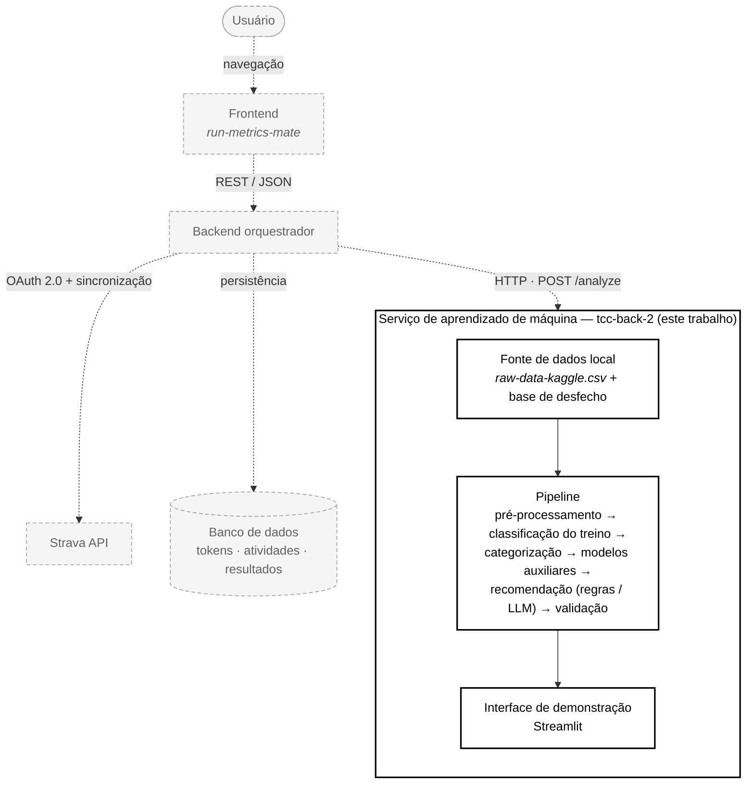

# 3 DESENVOLVIMENTO

Neste capítulo serão apresentados o desenvolvimento do serviço de análise e recomendação de treinos de corrida construído neste trabalho, os dados que o alimentam, as técnicas aplicadas em cada etapa do processamento e os experimentos conduzidos para medir se o que o sistema recomenda tem sustentação empírica. A seção 3.1 contém a especificação do software, com os requisitos funcionais e não funcionais derivados do que foi efetivamente implementado. A seção 3.2 descreve o modelo proposto etapa por etapa, partindo de uma visão geral do fluxo de trabalho e detalhando, em subseções próprias, a obtenção dos dados, a limpeza e o pré-processamento, a classificação do tipo de treino, a definição do perfil do atleta, a clusterização dos corredores, os modelos auxiliares de previsão, as duas estratégias de recomendação implementadas, o protocolo de validação adotado, os resultados obtidos, a evolução do projeto diante dos achados negativos e as ameaças à validade. Por fim, a seção 3.3 trata da operacionalidade da aplicação, apresentando as telas da demonstração desenvolvida e um caso de uso conduzido sobre um atleta real da base.

Um esclarecimento de escopo é necessário desde já, porque atravessa todo o capítulo. O artefato construído neste trabalho é um **serviço de aprendizado de máquina**, implementado como um pacote Python executável por linha de comando e por uma interface web de demonstração. Ele não é, no estado atual, um serviço HTTP, e não realiza a integração direta com a plataforma Strava. A arquitetura de ecossistema que contempla autenticação do usuário, sincronização de atividades e persistência em banco de dados existe como **especificação**, não como implementação, e está descrita na seção 3.3 sob esse rótulo. Ao longo do capítulo, sempre que uma funcionalidade for proposta e não implementada, o texto dirá isso explicitamente.

## 3.1 ESPECIFICAÇÃO

<!-- A ESCREVER -->

## 3.2 DESCRIÇÃO DO MODELO

O modelo desenvolvido neste trabalho não é um único algoritmo, e sim um encadeamento de etapas de processamento que recebe o histórico bruto de corridas de um conjunto de atletas e devolve, para um atleta consultado, a recomendação do próximo treino acompanhada de uma justificativa. Cada etapa consome a saída da anterior e produz uma estrutura de dados que a etapa seguinte espera; nenhuma etapa é opcional no caminho principal de execução. Essa organização em pipeline foi adotada por três razões: ela torna o processamento determinístico e reproduzível, o que é condição para que os experimentos da seção 3.2.9 tenham significado; ela permite isolar o efeito de cada componente, o que é explorado na análise de ablação relatada na seção 3.2.10; e ela permite que uma segunda fonte de dados, com esquema diferente, percorra exatamente o mesmo caminho de processamento, o que é o que viabiliza a validação externa descrita na seção 3.2.1.

A Figura 1 apresenta a visão geral do fluxo de trabalho, com as seis macroetapas do processamento e a indicação do que entra e do que sai de cada uma.

> **[INSERIR FIGURA 1 — Fluxo de trabalho do modelo proposto]**
> - **O que mostrar:** seis caixas empilhadas verticalmente, ligadas por setas descendentes, reproduzindo o "Mapa mental (o fluxo inteiro)" de `FLUXO.md` (linhas 15 a 51). As caixas, de cima para baixo: (1) COLETA — "CSV Kaggle (snapshot Strava)" com a anotação lateral "futuro: OAuth Strava via backend" em linha tracejada; (2) LIMPEZA E ENGENHARIA DE ATRIBUTOS — "gênero → frequência cardíaca → filtros → pace → tipo de treino relativo ao atleta"; (3) CATEGORIZAÇÃO — "perfil por regras (iniciante…avançado) + K-means por gênero → `perfil_cluster` ∈ {`volume_alto`, `volume_moderado`}"; (4) MODELOS AUXILIARES — "previsão de pace e de tempo: regressão linear, *Random Forest*, XGBoost, avaliados com `GroupKFold` por atleta"; (5) RECOMENDAÇÃO — caixa dividida em dois ramos paralelos, "A) déficit em relação à meta do *cluster* (regras)" e "B) Gemini (LLM) sobre as mesmas variáveis determinísticas"; (6) VALIDAÇÃO — três linhas: "1) eficácia por desfecho (tempo de 21 km) — veredito", "2) imitação de hábito — contraste", "3) protocolo dos oito modelos, ablação e meta aprendida". À esquerda de cada caixa, uma etiqueta pequena com o módulo do repositório que a implementa (`dataset/fontes/`, `dataset/preprocessamento.py`, `dataset/categorizar/`, `dataset/models/`, `dataset/models/previsao_treino/` e `gemini/`, `dataset/experimentos/`).
> - **Onde obter:** `FLUXO.md`, seção "Mapa mental (o fluxo inteiro)", e seção "Estrutura do código (onde achar cada etapa)".
> - **Como gerar/capturar/desenhar:** desenhar em draw.io (diagrams.net) ou em Mermaid (`flowchart TB`) e exportar em PNG com fundo branco, largura mínima de 1200 px; usar a mesma paleta em tons de cinza do restante do trabalho e reservar uma cor de destaque apenas para a caixa 5 (RECOMENDAÇÃO), que é o produto do trabalho.
> - **Legenda:** Figura 1 – Fluxo de trabalho do modelo proposto
> - **Fonte:** Fonte: elaborado pela autora.
> - **Posição:** imediatamente após este parágrafo, antes do parágrafo que enumera as etapas.

O fluxo de trabalho destaca as seguintes etapas: (i) a **coleta**, em que o histórico de corridas é obtido de conjuntos de dados públicos e carregado para a memória em um esquema único; (ii) a **limpeza e engenharia de atributos**, em que registros inválidos são descartados, valores ausentes são imputados e são derivadas as variáveis que não existem no dado bruto, notadamente o *pace* e o tipo de treino; (iii) a **categorização de corredores**, em que cada atleta recebe simultaneamente um rótulo interpretável produzido por regras e um rótulo produzido por agrupamento não supervisionado; (iv) os **modelos auxiliares**, que estimam o *pace* e o tempo de uma corrida a partir de suas características e servem de apoio analítico e de objeto de comparação metodológica; (v) a **recomendação**, que constitui o produto do trabalho e possui dois caminhos — um determinístico, baseado em regras de déficit de distribuição, e outro baseado em um modelo de linguagem de grande porte que redige o conselho sobre variáveis calculadas pelo próprio código; e (vi) a **validação**, conduzida em três frentes independentes, que mede se a recomendação produzida tem respaldo empírico.

A primeira etapa, a **coleta**, recebe como entrada arquivos de valores separados por delimitador, obtidos de repositórios públicos, e produz como saída um objeto `FonteDados`, que encapsula um *dataframe* no esquema canônico do projeto acompanhado de metadados sobre quais variáveis aquela fonte oferece. Essa etapa é implementada no pacote `dataset/fontes/`, com um módulo adaptador por fonte, e é justificada pela ADR-018, que estabeleceu a necessidade de uma segunda fonte de dados para a validação por desfecho. O detalhamento completo, incluindo a caracterização das duas fontes, o dicionário de variáveis e a volumetria medida, encontra-se na seção 3.2.1.

A segunda etapa, a **limpeza e engenharia de atributos**, recebe o *dataframe* bruto e devolve um *dataframe* em que cada linha representa uma corrida válida, acrescida das colunas derivadas `pace_min_km` e `tipo_treino`. Ela é implementada em `dataset/preprocessamento.py`, na função `preprocessar`, que encadeia quatro operações em ordem fixa, e é justificada pela ADR-003, que determinou que o pré-processamento fosse fixo e determinístico, e pela ADR-002, que concentrou todos os nomes de coluna e todos os limiares numéricos em `dataset/constants.py`. Os filtros aplicados e seus efeitos sobre a volumetria são descritos na seção 3.2.2; a regra de atribuição do tipo de treino, que é relativa ao histórico de cada atleta e não absoluta, é descrita na seção 3.2.3 e está justificada pela ADR-004.

A terceira etapa, a **categorização de corredores**, recebe o *dataframe* de corridas já processado e devolve uma tabela com uma linha por atleta, contendo as medianas de suas métricas de treino e dois rótulos de segmentação. O primeiro rótulo, `perfil_atleta`, assume os valores `iniciante`, `intermediario`, `fundista` ou `avancado` e é produzido por um conjunto de regras sobre três eixos — *pace*, volume semanal e distância típica —, implementado em `dataset/categorizar/definir_perfil_atleta.py` e justificado pela ADR-005; ele existe porque um centroide de K-means não é autoexplicativo e tanto a banca quanto o usuário final precisam de um rótulo em linguagem natural. O segundo rótulo vem do agrupamento por K-means, treinado separadamente para homens e para mulheres sobre as variáveis distância e *pace* previamente padronizadas, implementado em `dataset/categorizar/kmeans.py` e justificado pela ADR-006; após a nomeação realizada em `dataset/categorizar/nomear_clusters.py`, esse rótulo é traduzido para a chave de produto `perfil_cluster`, que assume os valores `volume_alto` ou `volume_moderado`. O perfil por regras é detalhado na seção 3.2.4 e a clusterização, incluindo a escolha do número de grupos e as validações interna e externa, na seção 3.2.5.

A quarta etapa, os **modelos auxiliares**, recebe o *dataframe* de corridas e devolve, para cada modelo treinado, um objeto `ResultadoModelo` com as métricas de ajuste e os artefatos necessários à visualização. São modelos de regressão para previsão de *pace* e de tempo, implementados em `dataset/models/previsao_pace/` e `dataset/models/previsao_tempo/`, com o contrato de saída único estabelecido pela ADR-008. Esses modelos não constituem o produto do trabalho, mas cumprem duas funções: oferecem uma leitura quantitativa da relação entre as variáveis de treino e compõem o conjunto de oito modelos sobre o qual se demonstra, na seção 3.2.9, que o protocolo de avaliação originalmente adotado produzia métricas otimistas. A descrição dos modelos está na seção 3.2.6.

A quinta etapa, a **recomendação**, é o produto do trabalho e possui dois caminhos que compartilham as mesmas variáveis de entrada. O caminho principal, por regras, recebe o histórico recente do atleta — a janela das últimas seis semanas, fixada em `SEMANAS_JANELA = 6` — e o `perfil_cluster` a que ele pertence, compara a distribuição observada de tipos de treino com a meta definida para aquele agrupamento em `META_POR_PERFIL`, escolhe o tipo com maior déficit ponderado, aplica regras de contenção de fadiga e dimensiona distância, *pace* alvo e tempo estimado; é implementado em `dataset/models/previsao_treino/recomendacao_cluster.py` e em `recomendar_proximo_treino`, e está justificado pelas ADR-024 e ADR-026, que substituíram a regra de meta global da ADR-007. O caminho complementar entrega as mesmas variáveis, já calculadas pelo código, a um modelo de linguagem de grande porte, que devolve uma recomendação em formato estruturado validado por esquema; é implementado no pacote `gemini/` e justificado pela ADR-010, cuja premissa é que o modelo de linguagem deve redigir o conselho, não calcular os números, de modo a reduzir a superfície de alucinação. Os dois caminhos são detalhados, respectivamente, nas seções 3.2.7 e 3.2.8.

A sexta etapa, a **validação**, recebe os recomendadores e os modelos como objetos a serem avaliados e devolve tabelas de métricas acompanhadas de intervalos de confiança e de testes de hipótese. Ela é conduzida em três frentes, implementadas no pacote `dataset/experimentos/` sobre o protocolo definido em `dataset/avaliacao/`. A primeira frente mede a **eficácia por desfecho**: verifica, em uma base independente que possui tempos de prova, se os atletas cuja distribuição de treinos está mais próxima da meta apresentam melhores tempos de meia maratona; é o veredito do trabalho, e está justificada pelas ADR-018 e ADR-026. A segunda frente mede a **imitação de hábito**: verifica se o sistema acerta qual foi o próximo tipo de treino que o atleta de fato realizou, comparando-se a sete recomendadores triviais; essa frente é apresentada deliberadamente como contraste, e não como veredito, porque acertar o hábito de um atleta que treina mal não é evidência de bom conselho, conforme registrado na ADR-017. A terceira frente é o **protocolo metodológico** sobre os oito modelos, a ablação dos componentes da regra e a tentativa de aprender a meta ótima a partir do desfecho, esta última justificada pela ADR-019. As três frentes são descritas na seção 3.2.9 e seus resultados, na seção 3.2.10.

Cabe delimitar, antes do detalhamento, o que está implementado e o que está apenas proposto. Está implementado e executável neste repositório tudo o que foi descrito nos seis parágrafos anteriores: o carregamento das duas fontes, o pré-processamento, a categorização, os modelos auxiliares, os dois caminhos de recomendação, os experimentos de validação e a interface de demonstração. Está apenas **proposto**, em estado de especificação, o ecossistema de produto que envolveria este serviço: a autenticação do usuário junto à plataforma Strava pelo protocolo OAuth 2.0, a sincronização periódica das atividades, a persistência em banco de dados e a exposição deste serviço de aprendizado de máquina por meio de uma interface HTTP, cujo contrato previsto é a requisição `POST /analyze`. Essa interface consta da ADR-009 com estado *Proposta* e é especificada no documento `SPEC-BACKEND-ORQUESTRADOR.md`, cujo estado é *Draft*. Nenhuma linha de código deste repositório expõe ou consome essa interface. A Figura 2 apresenta a arquitetura pretendida, com a demarcação explícita da fronteira entre o implementado e o proposto.

Figura 2 – Arquitetura do ecossistema e fronteira do que foi implementado



Legenda do diagrama: linha contínua indica o que foi implementado neste trabalho; linha tracejada e preenchimento acinzentado indicam o que é apenas proposto (ADR-009, estado *Proposta*; `SPEC-BACKEND-ORQUESTRADOR.md`, estado *Draft*). As setas tracejadas representam trocas bidirecionais, rotuladas pelo protocolo previsto; o sentido indicado é o da requisição.

Fonte: elaborado pela autora.

A leitura da Figura 2 deixa evidente que o trabalho aqui relatado ocupa deliberadamente uma fatia estreita e profunda do ecossistema. A opção por concentrar o esforço no serviço de aprendizado de máquina, em vez de distribuí-lo entre autenticação, sincronização e interface de produção, decorre da natureza da contribuição pretendida: a questão de pesquisa é se a recomendação de distribuição de treinos tem sustentação empírica, e essa questão se responde com dados e experimentos, não com infraestrutura. A integração com a plataforma Strava, embora necessária a um produto, não acrescentaria evidência à pergunta e introduziria dependências de rede, de credenciais e de limites de taxa que comprometeriam a reprodutibilidade dos experimentos. Essa escolha tem um custo, discutido na seção 3.2.1: o trabalho opera sobre dados secundários, sobre os quais não há controle de coleta.

As subseções a seguir detalham cada etapa. A seção 3.2.1 descreve a obtenção dos dados e caracteriza as duas fontes utilizadas. A seção 3.2.2 descreve a limpeza e o pré-processamento. A seção 3.2.3 descreve a classificação do tipo de treino. A seção 3.2.4 descreve a definição do perfil do atleta por regras. A seção 3.2.5 descreve a clusterização dos corredores e sua validação. A seção 3.2.6 descreve os modelos de previsão de *pace* e de tempo. A seção 3.2.7 descreve a recomendação por regras baseada no déficit em relação à meta do agrupamento. A seção 3.2.8 descreve a recomendação redigida por modelo de linguagem. A seção 3.2.9 descreve o protocolo de validação adotado. A seção 3.2.10 apresenta os resultados obtidos e sua análise. A seção 3.2.11 relata a evolução do projeto e os achados negativos que motivaram a substituição de decisões anteriores. Por fim, a seção 3.2.12 discute as ameaças à validade e as limitações do que foi medido.

### 3.2.1 Obtenção dos dados

Esta seção caracteriza as fontes de dados utilizadas, justifica a opção por dados secundários, apresenta o dicionário de variáveis e a volumetria medida de cada fonte, descreve a camada de adaptadores que as uniformiza e discute as questões éticas e as limitações decorrentes dessa escolha de coleta.

#### A opção por dados secundários públicos

A primeira decisão de coleta foi não realizar coleta primária. Entende-se por coleta primária, neste contexto, a obtenção de dados diretamente dos atletas, seja por instrumentação própria, seja por consumo autenticado da interface de programação de aplicações da plataforma Strava mediante consentimento individual. A alternativa adotada foi o uso de **dados secundários públicos**: conjuntos de dados previamente coletados, publicados sob licença aberta em repositório de acesso livre e reutilizados para finalidade distinta da original.

Três razões sustentam essa decisão. A primeira é a **reprodutibilidade**. Um experimento conduzido sobre a interface de programação da Strava depende, para ser repetido, de credenciais de aplicação válidas, de novos consentimentos dos mesmos atletas e de que o conteúdo das contas não tenha mudado no intervalo — condições que, na prática, tornam a repetição impossível. Um experimento conduzido sobre um arquivo versionado no repositório é repetível por qualquer leitor que clone o projeto, o que é especialmente relevante em um trabalho cuja contribuição central é metodológica e cujos resultados incluem achados negativos que precisam poder ser contestados. A segunda razão é o **volume histórico estável**. O trabalho exige histórico longo por atleta, porque a classificação do tipo de treino descrita na seção 3.2.3 é relativa ao próprio corredor e depende de estatísticas calculadas sobre o histórico dele, e porque a definição de perfil exige um mínimo de vinte corridas por atleta. Conjuntos públicos consolidados oferecem esse histórico de imediato; uma coleta primária em escala de trabalho de conclusão de curso dificilmente alcançaria centenas de corridas por atleta para mais de uma centena de atletas. A terceira razão é de **escopo e de natureza do artefato**: conforme registrado na ADR-009, a integração com a Strava é atribuição do backend orquestrador, que é um repositório distinto e ainda não construído; replicá-la aqui duplicaria responsabilidade e não acrescentaria evidência à questão de pesquisa.

O custo dessa decisão é real e deve ser declarado. Não há controle sobre o instrumento de medida: não se sabe qual dispositivo registrou cada atividade, com que precisão de posicionamento por satélite, nem se o atleta editou manualmente o registro. Não há acesso a variáveis de contexto que um protocolo de coleta próprio poderia capturar — lesão, qualidade do sono, condição climática, terreno, objetivo declarado de treino ou de prova. E não há possibilidade de contatar os sujeitos para esclarecer um registro anômalo; registros implausíveis só podem ser descartados por regra, o que é feito no pré-processamento descrito na seção 3.2.2. Essas limitações são retomadas, de forma consolidada, na seção 3.2.12.

#### Caracterização da fonte primária

A fonte primária do trabalho é o conjunto de dados `running-races-strava`, publicado no repositório Kaggle pelo usuário `olegoaer`. Trata-se de uma exportação consolidada de atividades de corrida registradas na plataforma Strava, em que cada linha corresponde a uma atividade individual — uma corrida — de um atleta identificado por um número inteiro. O arquivo está versionado no repositório deste trabalho em `dataset/raw-data-kaggle.csv`, o que significa que ele acompanha o código e dispensa qualquer etapa de aquisição por parte de quem queira reproduzir os resultados. O arquivo é um texto delimitado por ponto e vírgula, e não por vírgula, particularidade registrada na constante `SEPARADOR` do módulo `dataset/fontes/strava_kaggle.py` e que precisa ser informada explicitamente na leitura, sob pena de o arquivo inteiro ser interpretado como uma única coluna.

A granularidade do dado é a atividade: cada linha é uma corrida, com a data e a hora de início, a distância percorrida, o tempo decorrido, o ganho de elevação acumulado e, quando o atleta usava monitor cardíaco, a frequência cardíaca média do esforço. Não há registro intraatividade — não existem as séries temporais segundo a segundo que a plataforma armazena —, o que delimita o tipo de análise possível: é viável caracterizar o volume, a intensidade média e a composição do treino de um atleta ao longo de semanas, mas não é viável analisar a estrutura interna de uma sessão, como a duração dos tiros de um treino intervalado. Essa restrição é a razão de o tipo de treino precisar ser **inferido** a partir de estatísticas agregadas, conforme descrito na seção 3.2.3, em vez de lido de um campo.

As unidades do dado bruto são as do Sistema Internacional em sua forma básica: a distância é registrada em **metros**, o tempo decorrido em **segundos** e o ganho de elevação em **metros**. Nenhuma dessas unidades é a que o corredor usa na prática — que pensa em quilômetros, em minutos por quilômetro e em metros de altimetria —, de modo que a conversão para unidades interpretáveis é uma das tarefas da etapa de engenharia de atributos descrita na seção 3.2.2. O Quadro 3 apresenta o dicionário completo das variáveis da fonte primária, com o tipo inferido na leitura, a unidade, o domínio observado e o papel de cada uma neste trabalho.

Quadro 3 – Dicionário de variáveis da fonte primária

| Variável | Tipo | Unidade | Domínio observado | Papel no trabalho |
|---|---|---|---|---|
| `athlete` | Inteiro (Int64) | — | 116 valores distintos, esparsos e não sequenciais (por exemplo, 18042525); de 6 a 1.215 corridas por atleta, mediana de 269,5 | Identificador pseudônimo do corredor. Chave de agrupamento de todas as estatísticas por atleta (seção 3.2.3) e variável de grupo do particionamento experimental (seção 3.2.9) |
| `gender` | Texto (String) | — | `M` em 32.289 registros (76,67%), `F` em 9.472 (22,49%), nulo em 355 (0,84%) | Define a segmentação do agrupamento por K-means (seção 3.2.5); registros sem valor válido são descartados na limpeza (seção 3.2.2) |
| `timestamp` | Texto (String) | — | De 04/01/2000 12:06 a 06/01/2020 05:24, no formato `dd/mm/aaaa hh:mm`; nenhum valor fora do formato | Ordenação temporal de que dependem a janela móvel de seis semanas da recomendação (seção 3.2.7) e a avaliação por origem rolante (seção 3.2.9) |
| `distance (m)` | Real (Float64) | metro | Mínimo 0,0; primeiro quartil 7.189,7; mediana 10.137,0; terceiro quartil 13.236,3; máximo 218.950,0 | Variável de entrada do agrupamento (seção 3.2.5) e numerador do cálculo do *pace* (seção 3.2.2); base do critério de longão (seção 3.2.3) |
| `elapsed time (s)` | Inteiro (Int64) | segundo | Mínimo 0; mediana 3.442; máximo 2.971.531 | Denominador do cálculo do *pace*. Trata-se do tempo **decorrido**, e não do tempo em movimento, o que inclui pausas e explica parte dos valores extremos |
| `elevation gain (m)` | Real (Float64) | metro | Mínimo 0,0; mediana 86,0; máximo 12.078,5; nenhum valor nulo | Variável explicativa dos modelos auxiliares de previsão de *pace* e de tempo (seção 3.2.6); ausente na fonte secundária |
| `average heart rate (bpm)` | Real (Float64) | batimento por minuto | Ausente em 18.384 registros (43,65%); nos 23.732 presentes, mínimo 0,0, mediana 148,4 e máximo 237,0 | Critério auxiliar na classificação do treino intervalado (seção 3.2.3); por sua alta taxa de ausência, é objeto de imputação pela mediana (seção 3.2.2) |

Fonte: elaborado pela autora.

As sete variáveis são as seguintes. A variável `athlete` é um número inteiro que identifica o atleta de forma pseudônima; não é uma chave sequencial, e sim o identificador numérico atribuído pela própria plataforma, de modo que os valores são esparsos — o primeiro atleta do arquivo, por exemplo, tem o identificador 18042525. Seu papel neste trabalho é duplo e central: ela é a chave de agrupamento de todas as estatísticas relativas ao corredor, conforme a seção 3.2.3, e é a variável de grupo do particionamento experimental descrito na seção 3.2.9, que garante que nenhuma corrida de um mesmo atleta apareça simultaneamente nos conjuntos de treino e de teste. A variável `gender` é um texto com os valores `M` e `F`, além de ausências; ela determina a segmentação do agrupamento por K-means descrita na seção 3.2.5, adotada porque as distribuições de distância e de *pace* diferem sistematicamente entre os dois grupos e misturá-las distorceria os centroides, conforme a ADR-006. A variável `timestamp` é um texto com data e hora no formato `dd/mm/aaaa hh:mm`, padrão adotado como convenção de todo o projeto e declarado na constante `FORMATO_TIMESTAMP` de `dataset/fontes/base.py`; ela define a ordenação temporal de que dependem tanto a janela móvel de seis semanas usada pela recomendação, descrita na seção 3.2.7, quanto a avaliação por origem rolante, descrita na seção 3.2.9. A variável `distance (m)` é um número de ponto flutuante com a distância em metros; é uma das duas variáveis de entrada do agrupamento e o numerador implícito do cálculo do *pace*. A variável `elapsed time (s)` é um número inteiro com o tempo total decorrido em segundos; cabe notar que se trata do tempo **decorrido**, e não do tempo em movimento, o que significa que pausas longas — um semáforo, uma interrupção do treino — estão incluídas, fato que explica parte dos valores extremos discutidos adiante. A variável `elevation gain (m)` é o ganho acumulado de altimetria em metros, usada como variável explicativa nos modelos auxiliares da seção 3.2.6 e ausente na fonte secundária. Por fim, a variável `average heart rate (bpm)` é a frequência cardíaca média em batimentos por minuto, utilizada como critério auxiliar na classificação do treino intervalado descrita na seção 3.2.3 e, por sua alta taxa de ausência, objeto de imputação na seção 3.2.2.

A Tabela 1 apresenta as cinco primeiras linhas do arquivo bruto, exatamente como estão no disco, para tornar concreto o formato descrito.

> **[INSERIR TABELA 1 — Amostra das cinco primeiras linhas da fonte primária]**
> - **O que mostrar:** as cinco linhas reproduzidas no parágrafo seguinte, em tabela com cabeçalho igual ao do arquivo. Não é necessária anonimização: o campo `athlete` já é um identificador numérico pseudônimo.
> - **Onde obter:** `dataset/raw-data-kaggle.csv`, linhas 1 a 6 (cabeçalho mais cinco registros); confirmado por `pl.read_csv("dataset/raw-data-kaggle.csv", separator=";").head(5)`.
> - **Como gerar:** copiar da saída do comando acima; formatar como tabela do editor, preservando os valores originais sem arredondamento.
> - **Legenda:** Tabela 1 – Amostra das cinco primeiras linhas da fonte primária
> - **Fonte:** Fonte: elaborado pela autora, a partir de olegoaer (2022).
> - **Posição:** após este parágrafo.

Os cinco registros são, respectivamente: atleta 18042525, gênero M, 15/12/2019 09:08, 2.965,8 m, 812 s, 17,4 m, 150,3 bpm; o mesmo atleta em 10/12/2019 19:27, 10.020,8 m, 3.290 s, 52,2 m, 160,8 bpm; em 03/12/2019 19:46, 12.132,2 m, 4.027 s, 249,0 m, 148,9 bpm; em 26/11/2019 19:46, 11.631,5 m, 4.442 s, 194,0 m, 136,2 bpm; e em 19/11/2019 19:45, 11.708,1 m, 4.022 s, 250,7 m, 146,0 bpm. Três observações se extraem dessa amostra e orientam o restante do capítulo. Primeiro, o arquivo está ordenado de forma decrescente no tempo dentro de cada atleta, o que obriga a ordenação explícita sempre que a sequência temporal importar. Segundo, os registros do mesmo atleta revelam o que a classificação relativa da seção 3.2.3 explora: a primeira corrida tem menos de um terço da distância das demais e um *pace* visivelmente mais rápido, enquanto as outras quatro são próximas entre si — é essa variação **interna ao atleta** que permite distinguir um treino do outro sem recorrer a limiares absolutos. Terceiro, as corridas ocorrem majoritariamente no fim da tarde e em dias de semana, padrão compatível com o corredor amador que treina fora do horário de trabalho, que é o público-alvo deste trabalho.

#### Volumetria medida da fonte primária

Todos os números desta subseção foram apurados por execução direta sobre o arquivo versionado, com a biblioteca Polars, no ambiente virtual do repositório, e estão registrados em `tcc/01-FATOS.md` com a respectiva procedência. O arquivo contém **42.116 registros de corrida** distribuídos entre **116 atletas distintos**, em sete colunas. O volume por atleta é bastante desigual: o atleta com menos registros tem 6 corridas, a mediana é de 269,5 corridas por atleta e o atleta com mais registros tem 1.215 corridas. Essa desigualdade tem duas consequências diretas. A primeira é que qualquer estatística agregada sobre o total de corridas é dominada pelos atletas mais prolíficos, razão pela qual o trabalho reporta, em paralelo, estatísticas agregadas e medianas por atleta, distinção retomada na seção 3.2.10. A segunda é que o particionamento experimental precisa ser feito por atleta e não por corrida, sob pena de o mesmo corredor ocupar os dois lados da partição, questão central da seção 3.2.9.

Quanto à distribuição por gênero, há 32.289 registros com `gender = M`, correspondendo a 76,67% do total, 9.472 registros com `gender = F`, correspondendo a 22,49%, e 355 registros sem valor, correspondendo a 0,84%. O desequilíbrio entre os dois gêneros é acentuado e precisa ser considerado na leitura dos agrupamentos: o K-means feminino é treinado sobre aproximadamente um quarto do volume do masculino, o que afeta a estabilidade dos centroides, discutida na seção 3.2.5.

A ausência de dados concentra-se em uma única variável. A frequência cardíaca média está ausente em **18.384 registros, isto é, 43,65% do total**; nas demais seis colunas não há valores ausentes. Esse número é o fato isolado mais importante desta seção para as decisões que se seguem: quase metade das corridas da base não traz informação de intensidade fisiológica. É ele que justifica a decisão de imputar a frequência cardíaca pela mediana em vez de descartar os registros incompletos — descartá-los custaria mais de dezoito mil corridas —, decisão registrada na ADR-003 e detalhada na seção 3.2.2; é ele, também, que explica por que a frequência cardíaca entra na classificação do tipo de treino apenas como critério **auxiliar**, subordinado ao *pace*, conforme a seção 3.2.3. Nos 23.732 registros em que a frequência cardíaca está presente, a mediana é de 148,4 bpm e os valores vão de 0,0 a 237,0 bpm, intervalo que inclui valores fisiologicamente impossíveis e motiva o filtro de validade aplicado no pré-processamento.

As demais variáveis apresentam distribuições com cauda longa à direita e valores extremos implausíveis. A distância tem mediana de 10.137,0 m, primeiro quartil de 7.189,7 m e terceiro quartil de 13.236,3 m, mas o mínimo é 0,0 m e o máximo é 218.950,0 m, ou seja, quase 219 km em um único registro. O tempo decorrido tem mediana de 3.442 s, aproximadamente 57 minutos, mas o máximo é 2.971.531 s, equivalentes a mais de trinta e quatro dias, o que só pode ser um registro iniciado e não encerrado pelo atleta. O ganho de elevação tem mediana de 86,0 m e máximo de 12.078,5 m. Esses extremos não são erros de leitura do arquivo: são o ruído característico de dados gerados por dispositivos de consumo, e sua existência é precisamente o que a ADR-003 antecipa ao determinar um pipeline fixo de filtros. O efeito combinado desses filtros reduz o conjunto de 42.116 para **40.534 corridas** e de 116 para **114 atletas**, conforme apurado por execução de `preprocessar` e detalhado na seção 3.2.2.

A distribuição temporal dos registros também merece registro, porque delimita a validade externa dos achados. Embora o intervalo nominal da variável `timestamp` vá de 04/01/2000 12:06 a 06/01/2020 05:24, a massa de dados está concentrada nos últimos anos da série: há 1 registro em 2000, 4 em 2010, 1 em 2011, 61 em 2012, 332 em 2013, 975 em 2014, 2.237 em 2015, 4.463 em 2016, 8.243 em 2017, 12.230 em 2018, 13.411 em 2019 e 158 em 2020. Os anos de 2017 a 2019 concentram 33.884 registros, ou seja, 80,5% do total. O registro isolado de 2000 é, com alta probabilidade, um artefato de relógio mal configurado, e não uma corrida efetivamente realizada naquela data; ele não é removido por nenhum filtro atual, por não violar nenhuma regra de distância, *pace* ou frequência cardíaca, mas é irrelevante em termos de volume. A Figura 3 apresenta essa distribuição.

> **[INSERIR FIGURA 3 — Distribuição anual dos registros da fonte primária]**
> - **O que mostrar:** gráfico de barras verticais; eixo horizontal com os anos de 2000 a 2020; eixo vertical com a contagem de registros; rótulo numérico acima de cada barra. Destacar visualmente, com cor mais escura ou hachura, as barras de 2017, 2018 e 2019, que concentram 80,5% dos dados.
> - **Onde obter:** execução em Polars sobre `dataset/raw-data-kaggle.csv`: `df.with_columns(pl.col("timestamp").str.strptime(pl.Datetime, "%d/%m/%Y %H:%M").dt.year().alias("ano"))["ano"].value_counts().sort("ano")`. Os valores já estão apurados em `tcc/01-FATOS.md` (fato F16).
> - **Como gerar:** matplotlib, em um script ou célula de *notebook*; salvar em PNG com 150 dpi e fundo branco.
> - **Legenda:** Figura 3 – Distribuição anual dos registros da fonte primária
> - **Fonte:** Fonte: elaborado pela autora.
> - **Posição:** após este parágrafo, antes da interpretação que o segue.

A leitura da Figura 3 sustenta duas afirmações. A primeira é que, apesar do intervalo nominal de vinte anos, o conjunto retrata de fato o comportamento de corredores no período de 2016 a 2019, o que é coerente com a popularização dos relógios com posicionamento por satélite e das plataformas sociais de treino nesse intervalo. A segunda é que a base **antecede a pandemia de covid-19**, cujo efeito sobre os hábitos de treino dos corredores amadores foi substancial; os resultados aqui obtidos descrevem, portanto, um regime pré-pandêmico, e sua extrapolação para o comportamento atual exigiria nova coleta. Essa é uma limitação de validade externa retomada na seção 3.2.12.

#### Caracterização da fonte secundária e a necessidade de um desfecho

A fonte primária permite descrever como os atletas treinam, mas não permite avaliar se treinam bem. A razão é a ausência de uma **variável de desfecho**: não há, no conjunto, nenhuma medida de resultado — tempo de prova, classificação, evolução de desempenho — contra a qual se possa confrontar a recomendação produzida pelo sistema. Sem desfecho, a única pergunta respondível é se o sistema consegue prever qual será o próximo tipo de treino que o atleta realizará, o que mede **imitação de hábito**. O problema dessa métrica, registrado na ADR-017 e na ADR-018, é lógico antes de ser estatístico: um atleta que treina mal é imitado com sucesso por um recomendador que aconselha mal, de modo que um alto acerto de imitação não é evidência de boa recomendação, e um baixo acerto não é evidência de má recomendação. Avaliar a recomendação contra a própria meta que a origina seria igualmente circular. Foi essa constatação que motivou a adoção de uma segunda fonte de dados.

A fonte secundária é o conjunto `long-distance-running-dataset`, publicado no Kaggle pelo usuário `mexwell` sob licença Creative Commons Atribuição 4.0 Internacional, conforme registrado na ADR-018 e no cabeçalho do script de aquisição. Trata-se de um painel denso de treinos de corredores de longa distância referente aos anos de 2019 e 2020, com uma linha por atleta e por período — diária, semanal, mensal ou trimestral, conforme o arquivo —, acompanhado de atributos de caracterização do atleta que não existem na fonte primária: `age_group`, com a faixa etária, `country`, com o país, e `major`, que indica quais das grandes maratonas internacionais o atleta disputou. É esse último campo que torna a fonte útil para o propósito deste trabalho: cruzando-o com a data oficial de cada prova, é possível identificar esforços que são **corridas verificadas**, e não apenas treinos longos, conforme descrito na seção 3.2.9.

O desfecho principal extraído dessa fonte é o **melhor tempo do atleta na meia maratona**, operacionalizado em `dataset/experimentos/desfecho.py` como o melhor esforço registrado em uma distância de 21,0975 km com tolerância de 0,6 km, valores fixados nas constantes `DISTANCIA_MEIA_KM` e `TOLERANCIA_PROVA_KM` de `dataset/constants.py`. A escolha da meia maratona como distância principal, em vez da maratona, decorre do público do trabalho: o corredor amador, para quem 21 km é a distância de prova dominante. A maratona, com 42,195 km, é usada como verificação de robustez. O preparo considerado para cada atleta é a janela de doze semanas anteriores à prova, com exigência de pelo menos vinte treinos registrados, conforme as constantes `SEMANAS_PREPARO` e `MIN_TREINOS_PREPARO`.

A volumetria da fonte secundária foi apurada por varredura do arquivo `run_ww_2019_d.csv`, o painel diário de 2019, com leitura preguiçosa em Polars para não materializar o arquivo em memória. O arquivo ocupa aproximadamente 956 MB em disco e contém **13.290.380 linhas**, referentes a **36.412 atletas distintos**. Cabe uma ressalva de procedência: a ADR-018 registra "10,7 M registros" para essa fonte, número que não coincide com a contagem aqui medida; a divergência está registrada em `tcc/01-FATOS.md` sob o identificador C02 e o texto adota os valores medidos. Por se tratar de um painel denso, a maior parte das linhas não corresponde a corridas: os dias de descanso aparecem com `distance = 0`. Aplicando o filtro de distância positiva, restam **4.677.389 corridas efetivas**, ou 35,2% das linhas, proporção coerente com a estimativa de aproximadamente 65% de dias de descanso registrada na ADR-018. O número de atletas distintos não muda com o filtro, o que indica que todo atleta do painel tem ao menos um dia de corrida. O subconjunto desses atletas para o qual foi possível extrair um desfecho de meia maratona utilizável é de 6.821 atletas, número reportado nas ADR-018 e ADR-019 e não reexecutado nesta redação [CONFIRMAR NÚMERO: 6.821 atletas com desfecho de 21 km, valor das ADR-018/019; reexecutar com `python -m dataset.experimentos desfecho --max-atletas 12000`].

Duas características dessa fonte condicionam seu uso. A primeira é o **tamanho**: os quatro arquivos efetivamente utilizados — os painéis diário e semanal de 2019 e de 2020 — somam aproximadamente 394 MB compactados e 2,3 GB descompactados. Um volume dessa ordem não pode ser versionado em um repositório de código: inviabilizaria a clonagem, excederia os limites usuais de serviços de hospedagem de repositórios e, no caso específico do ambiente de desenvolvimento deste trabalho, seria sincronizado por um serviço de armazenamento em nuvem. Por essa razão, decidiu-se **não versionar** a fonte secundária e automatizar sua aquisição por meio do script `scripts/baixar_long_distance.sh`, que baixa o pacote do endpoint público do Kaggle — o qual, segundo o próprio script, dispensa credenciais —, extrai apenas os quatro arquivos de corrida, descartando os arquivos relativos à covid-19 que o pacote também contém, e grava o resultado no diretório indicado pela variável de ambiente `DIRETORIO_DADOS_EXTERNOS` ou, na ausência dela, em `~/.cache/tcc-back-2/dados`, deliberadamente fora da árvore sincronizada em nuvem. O script é idempotente: se os quatro arquivos já existirem no destino, ele termina sem baixar nada.

A segunda característica condicionante é a **ausência de variáveis fisiológicas e topográficas**. A fonte secundária não registra frequência cardíaca nem ganho de elevação. Essa ausência tem duas consequências. Para o pré-processamento, ela significa que o pipeline precisa detectar a situação e adaptar-se; conforme descrito na seção 3.2.2 e registrado na ADR-018, a versão original do pipeline **zerava** o conjunto ao processar essa fonte, porque a mediana de uma coluna integralmente nula é nula e a comparação de um valor nulo com o limiar de frequência cardíaca resulta em nulo, descartando todas as linhas. A correção consistiu em introduzir a função `tem_frequencia_cardiaca`, que detecta coluna ausente, integralmente nula ou constante, e propagar o indicador `usar_fc` pelas demais funções. Para a classificação do tipo de treino, ela significa que o critério de treino intervalado perde seu componente fisiológico e passa a depender apenas do *pace*, conforme a seção 3.2.3. Para os modelos auxiliares, ela significa que aqueles que exigem frequência cardíaca ou elevação como variável explicativa simplesmente não são aplicáveis a essa fonte, filtragem resolvida pelo campo `aplicavel` da estrutura `EspecModelo`, descrita na seção 3.2.6.

#### Esquema canônico e camada de adaptadores

As duas fontes descritas são heterogêneas em quase todos os aspectos: nomes de coluna, unidades, formato de data, granularidade e conjunto de variáveis disponíveis. Fazer o pipeline de processamento conhecer essas diferenças significaria espalhar condicionais por todos os módulos a jusante — o pré-processamento precisaria saber converter quilômetros em metros para uma fonte e não para a outra, a classificação precisaria saber se há frequência cardíaca, e assim por diante. Esse acoplamento tornaria qualquer terceira fonte uma alteração invasiva e, pior, tornaria impossível afirmar que as duas fontes passaram pelo **mesmo** tratamento, afirmação de que depende a validade da comparação entre elas.

A solução adotada, registrada na ADR-018, foi introduzir uma camada de adaptadores no pacote `dataset/fontes/`, organizada segundo o padrão de projeto homônimo: um módulo por fonte, cada um responsável por converter a representação específica daquela fonte para um **esquema canônico** único, definido em `dataset/fontes/base.py`. O esquema canônico é a lista `COLUNAS_CANONICAS`, composta pelas sete colunas da fonte primária — que, por ser a base do projeto, teve seu formato eleito como canônico —, todas referenciadas por constantes de `dataset/constants.py`, em observância à ADR-002, que proíbe literais de nome de coluna espalhados pelo código.

O contrato é materializado pela classe de dados imutável `FonteDados`, que agrega o nome da fonte, o *dataframe* já convertido e dois metadados booleanos, `tem_fc` e `tem_elevacao`. Esses metadados são a peça que permite ao restante do sistema adaptar-se sem inspecionar os dados: eles informam aos experimentos quais variáveis e quais modelos são aplicáveis àquela fonte. A classe valida o contrato na construção: seu método `__post_init__` verifica a presença de todas as colunas canônicas e lança exceção nomeando as que faltam, de modo que uma fonte mal adaptada falha imediatamente, e não dezenas de operações adiante com uma mensagem de erro incompreensível. A classe oferece ainda o método `resumo`, que devolve um dicionário com o nome da fonte, a contagem de corridas, a contagem de atletas e os dois indicadores, usado para registrar a procedência dos dados nas saídas dos experimentos.

O ganho concreto dessa camada é que o pipeline da seção 3.2.2, a categorização da seção 3.2.5 e os experimentos da seção 3.2.9 operam sobre `FonteDados` sem saber de qual conjunto os dados vieram. É isso que torna possível afirmar, por exemplo, que a distribuição de tipos de treino observada na fonte primária se reproduz na fonte externa, afirmação que sustenta o diagnóstico da seção 3.2.11 de que o desequilíbrio encontrado é propriedade do classificador e não artefato de um conjunto específico de dados. Sem o mesmo tratamento aplicado às duas fontes, essa comparação não teria valor.

O Quadro 4 apresenta o adaptador da fonte primária, que é o mais simples dos dois justamente porque seu formato é o canônico.

> **[INSERIR QUADRO 4 — Adaptador da fonte primária]**
> - **O que mostrar:** o conteúdo de `dataset/fontes/strava_kaggle.py`, das definições de constante até o fim da função `carregar_strava_kaggle`, com numeração de linhas à esquerda, em fonte monoespaçada e com destaque de sintaxe discreto. O trecho tem 15 linhas de código, abaixo do limite de 25 adotado no trabalho.
> - **Onde obter:** arquivo `dataset/fontes/strava_kaggle.py`.
> - **Como gerar:** copiar o trecho do arquivo e numerar as linhas a partir de 1; conferir que a numeração usada no parágrafo de explicação corresponde à do quadro final.
> - **Legenda:** Quadro 4 – Adaptador da fonte primária (`dataset/fontes/strava_kaggle.py`)
> - **Fonte:** Fonte: elaborado pela autora.
> - **Posição:** após este parágrafo, antes da explicação por faixa de linhas.

```python
 1  from pathlib import Path
 2
 3  import polars as pl
 4
 5  from dataset.fontes.base import FonteDados
 6
 7  CAMINHO_PADRAO = Path("dataset/raw-data-kaggle.csv")
 8  SEPARADOR = ";"
 9
10
11  def carregar_strava_kaggle(caminho: Path | str = CAMINHO_PADRAO) -> FonteDados:
12      """Carrega o CSV primário do projeto (separador `;`)."""
13      caminho = Path(caminho)
14      if not caminho.exists():
15          raise FileNotFoundError(f"dataset primário não encontrado em {caminho}")
16
17      return FonteDados(
18          nome="strava-kaggle",
19          df=pl.read_csv(caminho, separator=SEPARADOR),
20          tem_fc=True,
21          tem_elevacao=True,
22      )
```

As linhas 7 e 8 declaram, como constantes de módulo, o caminho padrão do arquivo versionado e o separador de campos, em conformidade com a ADR-002. A linha 11 define a função de carga, cujo único parâmetro é o caminho do arquivo, com valor padrão apontando para o arquivo do repositório; a tipagem `Path | str` permite tanto o uso idiomático quanto a passagem de uma cadeia de caracteres, e o retorno declarado `FonteDados` explicita o contrato. As linhas 13 a 15 fazem a verificação de existência e lançam `FileNotFoundError` com mensagem explícita; essa checagem antecipada evita que a ausência do arquivo se manifeste como um erro genérico de leitura mais adiante. As linhas 17 a 22 constroem o objeto de contrato: a linha 19 realiza a leitura efetiva com `pl.read_csv`, informando o separador — sem esse argumento, Polars assumiria a vírgula e produziria um *dataframe* de uma única coluna —, e as linhas 20 e 21 declaram que esta fonte oferece frequência cardíaca e elevação, informação que será consultada pelos experimentos. Observe-se que nenhuma conversão de unidade ou renomeação ocorre: o adaptador existe, neste caso, apenas para uniformizar a **interface**, não para transformar o dado, conforme explicitado na documentação do próprio módulo.

O contraste com o adaptador da fonte secundária evidencia o papel da camada. Nesse segundo caso, implementado em `dataset/fontes/long_distance.py`, cada coluna canônica é produzida por uma expressão de conversão: `athlete` e `gender` são apenas renomeadas; `datetime`, que vem no formato ISO `%Y-%m-%d`, é convertida para o tipo temporal e reformatada para a convenção `%d/%m/%Y %H:%M` do projeto; `distance`, que vem em quilômetros, é multiplicada por mil para virar `distance (m)`; `duration`, que vem em minutos, é multiplicada por sessenta para virar `elapsed time (s)`; e as colunas `elevation gain (m)` e `average heart rate (bpm)`, inexistentes na fonte, são criadas como literais nulos do tipo adequado, de modo que o esquema canônico seja satisfeito e o indicador `tem_fc=False` informe ao restante do sistema que não há conteúdo ali. Além disso, o adaptador aplica o filtro `distance > 0` que descarta os dias de descanso do painel denso e preserva, em caráter opcional, as três colunas extras `age_group`, `country` e `major`, necessárias à extração do desfecho. A leitura é feita com `pl.scan_csv`, que constrói um plano de execução preguiçoso, e a materialização ocorre com o motor de execução em fluxo contínuo; essa escolha é o que torna viável processar um arquivo de quase um gigabyte sem carregá-lo integralmente em memória. A função `carregar_long_distance` oferece ainda o parâmetro `max_atletas`, que filtra pelos identificadores menores que o valor informado — possível porque, nessa fonte, os identificadores são inteiros densos de 0 a 36.411 —, produzindo uma amostra reprodutível e barata para desenvolvimento, usada nas invocações da linha de comando documentadas na seção 3.2.9.

O Quadro 5 sintetiza o contraste entre as duas fontes.

Quadro 5 – Comparação entre a fonte primária e a fonte secundária

| Aspecto | Fonte primária | Fonte secundária |
|---|---|---|
| Identificador no Kaggle | `olegoaer/running-races-strava` | `mexwell/long-distance-running-dataset` |
| Papel no trabalho | Construção do sistema: limpeza, classificação do treino, agrupamento, modelos auxiliares e geração da recomendação | Validação externa: aferir se a premissa da regra se sustenta contra um desfecho de prova |
| Versionada no repositório | Sim — `dataset/raw-data-kaggle.csv` | Não |
| Forma de aquisição | Disponível no próprio repositório, sem download | Download sob demanda por `bash scripts/baixar_long_distance.sh`, para `~/.cache/tcc-back-2/dados` (sobrescrevível por `DIRETORIO_DADOS_EXTERNOS`) |
| Tamanho | 42.116 linhas de dados em um único arquivo | ~394 MB compactados, ~2,3 GB descompactados; quatro arquivos (painéis diário e semanal de 2019 e 2020) |
| Granularidade | Uma linha por corrida registrada | Uma linha por atleta por dia, incluindo dias sem treino; apenas 4.677.389 das 13.290.380 linhas do painel diário de 2019 (35,2%) têm distância maior que zero |
| Período coberto | 04/01/2000 a 06/01/2020, com 80,5% dos registros concentrados entre 2017 e 2019 | 2019 e 2020 |
| Número de atletas | 116 no arquivo bruto; 114 após o pré-processamento; 111 com ao menos 20 corridas | 36.412 no painel diário de 2019; 6.821 com desfecho de 21 km utilizável |
| Número de corridas | 42.116 no bruto; 40.534 após o pré-processamento | 4.677.389 corridas efetivas no painel diário de 2019 |
| Frequência cardíaca | Presente, ausente em 43,65% dos registros | Ausente — coluna criada nula pelo adaptador (`tem_fc=False`) |
| Elevação | Presente, sem valores nulos | Ausente — coluna criada nula pelo adaptador (`tem_elevacao=False`) |
| Atributos do atleta | `gender` apenas | `gender`, `age_group`, `country` e `major` |
| Variável de desfecho | — (nenhum resultado de prova) | Melhor tempo de 21,0975 km, com tolerância de 0,6 km; maratona usada como verificação de robustez |
| Adaptador | `dataset/fontes/strava_kaggle.py` | `dataset/fontes/long_distance.py` |

Fonte: elaborado pela autora.

A comparação consolidada no Quadro 5 explicita a divisão de trabalho entre as duas fontes e, ao mesmo tempo, a principal fragilidade do desenho. A fonte primária é pequena, rica em variáveis e versionada: serve para construir e demonstrar o sistema. A fonte secundária é grande, pobre em variáveis e externa: serve para testar se a premissa do sistema se sustenta. Nenhuma das duas faz as duas coisas, e — este é o ponto crítico — **as duas populações são disjuntas**. Não há identificador comum, não há sobreposição conhecida de atletas e não existe qualquer forma de ligar um corredor da base primária a um corredor da base de desfecho. A consequência metodológica é precisa e deve ser enunciada sem atenuação: o trabalho **não** mede o desfecho dos atletas a quem recomenda, nem recomenda aos atletas de quem mede o desfecho. O que se mede na fonte externa é se a **premissa** da regra — a de que uma determinada composição de treinos se associa a melhor desempenho — encontra respaldo em uma população independente de corredores. Isso é mais do que validação circular e menos do que validação do sistema, e é assim que deve ser lido. A limitação é retomada e consolidada na seção 3.2.12.

#### Questões éticas e de privacidade

Os dois conjuntos de dados utilizados são públicos, foram publicados por terceiros em repositório de acesso aberto e são reutilizados neste trabalho sem qualquer tratamento que permita reidentificação. Em ambas as fontes, os atletas são identificados exclusivamente por um número inteiro: não há nome, endereço de correio eletrônico, identificador de conta na plataforma, fotografia, nem coordenadas geográficas de início ou de término das atividades — elemento que, se estivesse presente, permitiria inferir local de residência e constituiria dado pessoal. Os atributos de caracterização disponíveis na fonte secundária são agregados e de baixa granularidade, como faixa etária e país, e não individualizam o sujeito. Não houve, em nenhum momento, coleta de dados junto a sujeitos humanos, aplicação de instrumento, intervenção ou contato com participantes; o trabalho opera integralmente sobre registros preexistentes e anônimos.

Quanto ao licenciamento, a fonte secundária é distribuída sob Creative Commons Atribuição 4.0 Internacional, conforme registrado na ADR-018 e no cabeçalho do script de aquisição, o que autoriza o uso e a redistribuição mediante atribuição ao autor original, atribuição feita nas referências deste trabalho. A licença da fonte primária não está registrada na documentação de decisões do projeto `[DADO PENDENTE: verificar e registrar a licença declarada na página do conjunto `olegoaer/running-races-strava` no Kaggle, bem como a data de acesso, para compor a referência segundo a NBR 6023]`. Registre-se, ainda, que o repositório do projeto não versiona credenciais: a chave de acesso à interface do modelo de linguagem descrita na seção 3.2.8 é lida de variável de ambiente, e o repositório versiona apenas o arquivo de exemplo `.env.example`, sem valores reais.

`[DECISÃO DA AUTORA: confirmar junto ao orientador se a monografia exige uma declaração formal sobre submissão a Comitê de Ética em Pesquisa. O entendimento adotado aqui é o de que a pesquisa com dados públicos, anonimizados e preexistentes, sem intervenção sobre sujeitos, dispensa submissão; se a instituição exigir manifestação, acrescentar parágrafo com o enquadramento normativo pertinente.]`

#### Limitações decorrentes da coleta

Encerra-se esta seção enunciando as limitações que decorrem especificamente das decisões de coleta, de modo a preparar a discussão consolidada da seção 3.2.12.

a) **Viés de autosseleção.** Os atletas presentes nas duas fontes são usuários de plataformas sociais de registro de treino. Quem registra sistematicamente suas corridas em uma plataforma e aceita tornar os dados públicos não é um corredor amador típico: tende a ser mais engajado, mais frequente e mais disciplinado. A mediana de 269,5 corridas por atleta na fonte primária é, ela própria, indício desse viés — não é o volume de um iniciante casual. Qualquer conclusão sobre "o corredor amador" deve ser lida como conclusão sobre "o corredor amador que registra treinos em plataforma digital e os torna públicos";

b) **Ausência de contexto.** Nenhuma das fontes informa lesão, doença, qualidade do sono, carga de trabalho, condição climática, terreno, altitude, nem o objetivo do atleta — se treina para uma prova específica, se está em base aeróbica ou em período de recuperação. Treinos leves podem indicar prudência periodizada ou recuperação de lesão, situações com significados opostos que o sistema não distingue;

c) **Imprecisão do instrumento.** Os dados provêm de dispositivos de consumo, com erro de posicionamento por satélite variável, e o tempo registrado é o decorrido, não o de movimento. Valores extremos como a corrida de 218.950 m ou o registro de 2.971.531 s evidenciam que atividades mal encerradas estão presentes no dado bruto;

d) **Populações disjuntas.** Conforme já exposto, não há ligação possível entre o atleta da fonte primária e o atleta da fonte de desfecho, o que impede a avaliação da recomendação sobre os mesmos indivíduos a quem ela se dirige;

e) **Recorte temporal pré-pandêmico.** A fonte primária concentra 80,5% dos registros entre 2017 e 2019 e a fonte secundária cobre 2019 e 2020, de modo que os padrões descritos antecedem, em sua maior parte, as mudanças de hábito de treino associadas à pandemia de covid-19;

f) **Desequilíbrio entre gêneros.** Com 76,67% de registros masculinos contra 22,49% de femininos, o agrupamento feminino descrito na seção 3.2.5 é estimado sobre volume substancialmente menor, com reflexos sobre a estabilidade dos centroides.

### 3.2.2 Limpeza e pré-processamento

<!-- A ESCREVER -->

### 3.2.3 Classificação do tipo de treino

<!-- A ESCREVER -->

### 3.2.4 Perfil do atleta por regras

<!-- A ESCREVER -->

### 3.2.5 Clusterização de corredores

<!-- A ESCREVER -->

### 3.2.6 Modelos de previsão de pace e de tempo

<!-- A ESCREVER -->

### 3.2.7 Recomendação por déficit em relação à meta do cluster

<!-- A ESCREVER -->

### 3.2.8 Recomendação via modelo de linguagem

<!-- A ESCREVER -->

### 3.2.9 Protocolo de validação

<!-- A ESCREVER -->

### 3.2.10 Resultados e análise

<!-- A ESCREVER -->

### 3.2.11 Evolução do projeto e achados negativos

<!-- A ESCREVER -->

### 3.2.12 Ameaças à validade e limitações

<!-- A ESCREVER -->

## 3.3 OPERACIONALIDADE DA APLICAÇÃO

<!-- A ESCREVER -->
